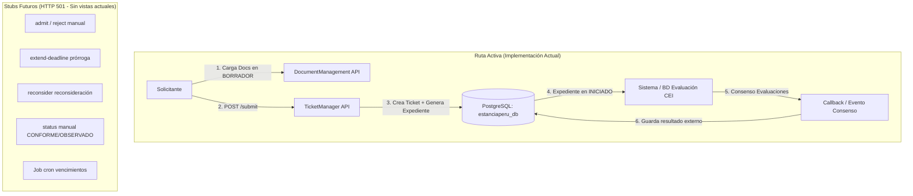
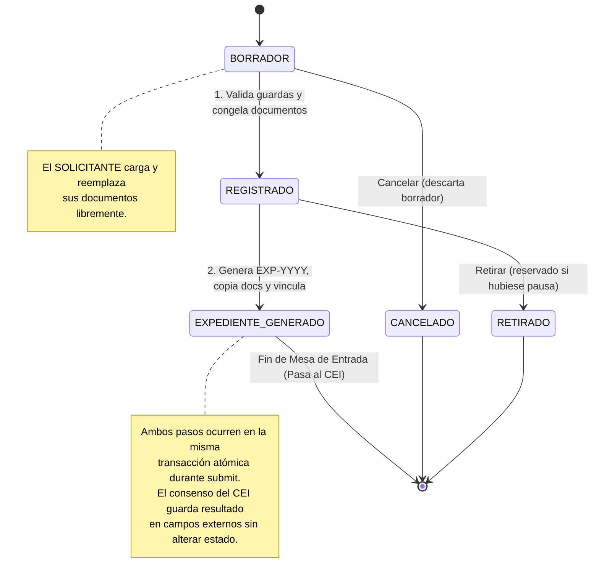

# Plan de Implementación Backend v2: TicketManager & DocumentManagement

Backend NestJS + PostgreSQL + Prisma. Mesa de entrada y admisibilidad de solicitudes (ticket) desacoplada de la evaluación ética/legal (expediente).

---

## 1. Arquitectura y Principios de Diseño



### Principios Fundamentales
1. **Desacoplamiento de Dominios**: El ticket es la mesa de entrada. Al enviarse (`submit`), se genera de forma inmediata e idempotente el `Expediente` en estado `INICIADO`. Ahí termina la responsabilidad de la mesa de entrada.
2. **Aprobación Automática por Consenso**: La resolución final no depende de botones de triaje manual, sino que se recibe de forma **automática** por el consenso de las evaluaciones de la BD del CEI.
3. **Misma Base de Datos (`estanciaperu_db`)**: Todo convive en el mismo motor relacional PostgreSQL, permitiendo sincronización directa o mediante evento/callback autenticado.
4. **Documentos Congelados tras el Envío**: La carga y reemplazo de documentos solo se permite en `BORRADOR` y solo por el `SOLICITANTE` propietario.
5. **Auditoría Estricta**: Cada transición y documento queda registrado con fecha, hash y autor (`SOLICITANTE`, miembros CEI o `SISTEMA`).

---

## 2. Matriz de Roles y Responsabilidades (Whitelist Estricta)

| Rol Institucional | Código de Rol | Responsabilidad en Mesa de Entrada |
| :--- | :--- | :--- |
| **Solicitante** | `SOLICITANTE` | Crea borrador, sube/reemplaza sus documentos, envía (`submit`) o descarta/retira (`cancel`/`withdraw`). Al hacer `submit`, el expediente se crea de forma **100% automática e inmediata**. |
| **Miembros del Comité CEI (5 Roles)** | `PRESIDENTE_CEI`<br>`VICEPRESIDENTE_CEI`<br>`SECRETARIA_TECNICA`<br>`SECRETARIA_ADMINISTRATIVA`<br>`VOCAL_CEI` | **Revisión y consulta colegiada**: Listan tickets, consultan detalle y descargan documentos para evaluarlos colegiadamente en el sistema del CEI. **Visibilidad restringida**: solo pueden ver y consultar tickets ya enviados (`EXPEDIENTE_GENERADO`). **Nunca ven borradores ajenos ni sus documentos.** |
| **Administrador** | `ADMINISTRADOR` | **Sin ninguna acción ni acceso en el ciclo de vida de los trámites** (soporte técnico exclusivo de plataforma). |

> **Nota de Conflicto de Intereses**: Si un usuario que posee un rol del CEI actúa como `SOLICITANTE` y registra una solicitud, el sistema de evaluación del CEI debe inhabilitarlo para votar o emitir dictamen sobre su propio expediente.

---

## 3. Reglas de Integridad Garantizadas en Base de Datos

| # | Regla | Mecanismo de Garantía |
| :--- | :--- | :--- |
| **R1** | Un solo documento **vigente** por `tipoDocumental` en cada ticket. Subir otro del mismo tipo lo reemplaza (versión anterior queda `REEMPLAZADO`). | Transacción de reemplazo + Índice único parcial en PostgreSQL. |
| **R2** | Tipos documentales normalizados (`trim().toUpperCase()`). Si hay catálogo se valida contra `RequisitoDocumental`; si no, se permite libre. Al enviar (`submit`), se exige obligatoriamente cada requisito marcado con `obligatorio: true`. | Validador DTO + guarda en `submit`. |
| **R3** | Un ticket genera **como máximo un expediente**, y un expediente pertenece a un solo ticket. | Relación `Ticket.expedienteId @unique`. |
| **R4** | `create-expediente` es **idempotente** desde `REGISTRADO` (o `ADMITIDO` a futuro): si ya existe, devuelve el existente sin duplicar. | Bloqueo optimista `updateMany` con `where: { id, estado: { in: ['REGISTRADO', 'ADMITIDO'] }, expedienteId: null }`. |
| **R5** | Se copian a `Documento` todos los `TicketDocumento` **vigentes** (`estado != 'REEMPLAZADO'`). Un documento de ticket se copia una sola vez. | Restricción `Documento.ticketDocumentoId @unique`. |
| **R6** | Control de solicitudes duplicadas **activas** del mismo solicitante. No bloquea de por vida: permite reenviar si la solicitud fue cancelada, retirada, archivada o si recibió dictamen no aprobado en el CEI. | Índice único parcial SQL sobre `(solicitanteId, claveDuplicidad)` excluyendo estados terminales cerrados y resoluciones no aprobadas. |
| **R7** | Correlativos `TCK-YYYY-XXXX` y `EXP-YYYY-XXXX` correlativos y seguros ante concurrencia. | Tabla `Secuencia` con incremento atómico transaccional y reintento ante colisión de creación de año (`P2002`). |

---

## 4. Modelo de Datos Prisma (`schema.prisma`)

```prisma
enum EstadoTicket {
  BORRADOR
  REGISTRADO
  EN_REVISION_PREVIA // Para futuro triaje
  OBSERVADO          // Para futuro triaje administrativo
  SUBSANADO          // Para futuro triaje
  ADMITIDO           // Para futuro triaje
  EXPEDIENTE_GENERADO // Estado terminal de la mesa de entrada
  RECHAZADO          // Para futuro rechazo administrativo
  CANCELADO          // Borrador descartado
  RETIRADO           // Solicitante retira antes de generar expediente
  ARCHIVADO          // Futuro: vencimiento por job
}

enum PrioridadTicket {
  BAJA
  NORMAL
  ALTA
  URGENTE
}

enum EstadoDocumentoAdjunto {
  PENDIENTE_VALIDACION
  CONFORME
  OBSERVADO
  REEMPLAZADO
}

// ---------- Catálogo Opcional ----------
model TipoTramite {
  id          String                @id @default(cuid())
  codigo      String                @unique
  nombre      String
  activo      Boolean               @default(true)
  requisitos  RequisitoDocumental[]
  tickets     Ticket[]

  @@map("tipos_tramite")
}

model RequisitoDocumental {
  id             String      @id @default(cuid())
  tipoTramiteId  String
  tipoTramite    TipoTramite @relation(fields: [tipoTramiteId], references: [id])
  tipoDocumental String      // Normalizado: 'PROTOCOLO', 'CONSENTIMIENTO_INFORMADO'
  obligatorio    Boolean     @default(true)

  @@unique([tipoTramiteId, tipoDocumental])
  @@map("requisitos_documentales")
}

// ---------- Secuencias Atómicas ----------
model Secuencia {
  clave  String @id          // 'TCK-2026', 'EXP-2026'
  ultimo Int    @default(0)

  @@map("secuencias")
}

// ---------- Ticket ----------
model Ticket {
  id                   String          @id @default(cuid())
  codigo               String          @unique // TCK-YYYY-XXXX
  titulo               String          // Título del proyecto/trámite (sin default genérico)
  descripcion          String?         @db.Text
  categoria            String?         // Nullable por ahora
  tipoTramiteId        String?         // Opcional / Nullable
  tipoTramite          TipoTramite?    @relation(fields: [tipoTramiteId], references: [id])
  estado               EstadoTicket    @default(BORRADOR)
  prioridad            PrioridadTicket @default(NORMAL)
  claveDuplicidad      String?

  // ---------- Paso 1: Datos Generales del Proyecto ----------
  investigadores       String[]        @default([]) // Investigador(es) Responsable(s)
  unidadAcademica      String?         @default("NA") // Unidad Académica / Facultad (Fijado en "NA" según formulario)
  tipoInvestigacion    String?         // Tesis de pregrado | Tesis de posgrado | Proyecto de investigación docente | Otro
  fechaPresentacion    DateTime?       // Fecha de Presentación de la solicitud
  financiamiento       String?         // Autofinanciado | UNTELS | Externo
  financiamientoDetalle String?        // Especificación si financiamiento es 'Externo'

  // ---------- Paso 2: Datos del Expediente ----------
  naturalezaProyecto   String?         // Naturaleza del proyecto (Biomédica, Observacional, etc.)
  participantes        String[]        @default([]) // Participantes / Sujetos del estudio
  modalidad            String?         // Modalidad de la investigación (Presencial, Remota, etc.)
  planProyecto         String?         // Plan de Proyecto (descripción o archivo subido)
  codigoSolicitante    String?         // "Escribe el codigo" del solicitante (ej. EXP-092)

  solicitanteId        String
  solicitante          Usuario         @relation("TicketSolicitante", fields: [solicitanteId], references: [id])
  asignadoAId          String?
  asignadoA            Usuario?        @relation("TicketAsignado", fields: [asignadoAId], references: [id])

  // Vinculación 1 a 1 con Expediente (R3)
  expedienteId         String?         @unique
  expediente           Expediente?     @relation("ExpedienteTicket", fields: [expedienteId], references: [id])

  metadata             Json?

  // Plazos y SLA (stubs futuros)
  plazoSubsanacion     DateTime?
  prorrogaDias         Int             @default(0)
  slaPausadoDesde      DateTime?
  diasPausados         Int             @default(0)
  plazoReconsideracion DateTime?
  fechaRespuesta       DateTime?

  // Campos para recepción automática del consenso del CEI
  resultadoEvaluacionExterna String?   // 'APROBADO', 'APROBADO_CON_OBSERVACIONES', 'NO_APROBADO'
  calificacionExternaJson    Json?      // Dictamen, acta, detalle de votos
  fechaRecepcionEvaluacion   DateTime?  // Timestamp de recepción automática

  creadoEn             DateTime        @default(now())
  actualizadoEn        DateTime        @updatedAt
  cerradoEn            DateTime?

  documentos           TicketDocumento[]
  historial            TicketHistorial[]
  observaciones        TicketObservacion[]

  @@index([solicitanteId])
  @@index([asignadoAId])
  @@index([estado])
  @@map("tickets")
}

// ---------- Documentos del Ticket ----------
model TicketDocumento {
  id             String                 @id @default(cuid())
  ticketId       String
  ticket         Ticket                 @relation(fields: [ticketId], references: [id], onDelete: Cascade)

  nombreOriginal String
  nombreArchivo  String
  tipoDocumental String                 // Normalizado en UPPERCASE
  mimeType       String
  tamanioBytes   Int
  hashSha256     String
  storagePath    String
  version        Int                    @default(1)

  estado         EstadoDocumentoAdjunto @default(PENDIENTE_VALIDACION)
  subidoPorId    String
  subidoPor      Usuario                @relation(fields: [subidoPorId], references: [id])
  observaciones  TicketObservacion[]

  creadoEn       DateTime               @default(now())
  actualizadoEn  DateTime               @updatedAt

  @@unique([ticketId, tipoDocumental, version])
  @@index([ticketId])
  @@index([hashSha256])
  @@map("ticket_documentos")
}

model TicketObservacion {
  id          String           @id @default(cuid())
  ticketId    String
  ticket      Ticket           @relation(fields: [ticketId], references: [id], onDelete: Cascade)
  autorId     String
  autor       Usuario          @relation(fields: [autorId], references: [id])
  contenido   String           @db.Text
  documentoId String?
  documento   TicketDocumento? @relation(fields: [documentoId], references: [id], onDelete: SetNull)
  resuelta    Boolean          @default(false)
  creadoEn    DateTime         @default(now())
  resueltaEn  DateTime?

  @@index([ticketId])
  @@map("ticket_observaciones")
}

model TicketHistorial {
  id             String        @id @default(cuid())
  ticketId       String
  ticket         Ticket        @relation(fields: [ticketId], references: [id], onDelete: Restrict)
  estadoAnterior EstadoTicket?
  estadoNuevo    EstadoTicket
  motivo         String?
  accion         String
  usuarioId      String?       // null = SISTEMA
  usuario        Usuario?      @relation(fields: [usuarioId], references: [id])
  metadata       Json?
  creadoEn       DateTime      @default(now())

  @@index([ticketId])
  @@map("ticket_historial")
}
```

### 4.1 Mapeo de Campos del Formulario de Solicitud (Aceptan Null / "NA")

#### Paso 1: Datos Generales del Proyecto
| Campo del Formulario (Frontend) | Columna Base de Datos | Tipo SQL / Prisma | Soporta Null / "NA" | Descripción y Comportamiento |
| :--- | :--- | :--- | :--- | :--- |
| **Título del Proyecto** | `Ticket.titulo` | `VARCHAR(500)` | No (Requerido) | Nombre del proyecto de investigación o trámite. |
| **Investigador(es) Responsable(s)** | `Ticket.investigadores` | `TEXT[]` / `String[]` | **SÍ (`[]` vacío)** | Lista de nombres de investigadores/docentes responsables (chips/lista en el UI). |
| **Unidad Académica / Facultad** | `Ticket.unidadAcademica` | `VARCHAR(100)` | **SÍ (`"NA"`)** | Actualmente el formulario tiene fijado `<option value="NA">NA</option>`. Almacena `"NA"` o `null`. |
| **Tipo de Investigación** | `Ticket.tipoInvestigacion` | `VARCHAR(100)` | **SÍ (`NULL`)** | Opciones institucionales: `Tesis de pregrado`, `Tesis de posgrado`, `Proyecto de investigación docente`, `Otro`. |
| **Fecha de Presentación** | `Ticket.fechaPresentacion` | `TIMESTAMP` | **SÍ (`NULL`)** | Fecha seleccionada en el input `date` del formulario (o `now()` si no se indica). |
| **Financiamiento** | `Ticket.financiamiento` | `VARCHAR(100)` | **SÍ (`NULL`)** | Opciones: `Autofinanciado`, `UNTELS`, `Externo`. |
| **Financiamiento Detalle** | `Ticket.financiamientoDetalle` | `VARCHAR(255)` | **SÍ (`NULL`)** | Campo condicional cuando se selecciona `Externo` (o especificación adicional). |

#### Paso 2: Datos del Expediente
| Campo del Formulario (Frontend) | Columna Base de Datos | Tipo SQL / Prisma | Soporta Null / "NA" | Descripción y Comportamiento |
| :--- | :--- | :--- | :--- | :--- |
| **"Escribe el codigo"** | `Ticket.codigoSolicitante` | `VARCHAR(100)` | **SÍ (`NULL`)** | **Código manual ingresado por el solicitante** (ej. `EXP-092`, código de protocolo). Distinto del correlativo del sistema. |
| **Naturaleza del Proyecto** | `Ticket.naturalezaProyecto` | `VARCHAR(255)` | **SÍ (`NULL`)** | Clasificación del proyecto (Biomédica, Observacional, etc.). Si no hay catálogo, almacena el texto ingresado. |
| **Participantes** | `Ticket.participantes` | `TEXT[]` / `String[]` | **SÍ (`[]` vacío)** | Población objeto, grupos o sujetos del estudio. |
| **Modalidad** | `Ticket.modalidad` | `VARCHAR(100)` | **SÍ (`NULL`)** | Modalidad de ejecución (Presencial, Virtual, Mixta, etc.). |
| **Plan de Proyecto** | `Ticket.planProyecto` | `TEXT` | **SÍ (`NULL`)** | Resumen o nombre del archivo cargado. El PDF/Word formal se archiva en `TicketDocumento`. |
| **Metadatos Adicionales** | `Ticket.metadata` | `JSONB` | **SÍ (`NULL`)** | Contenedor flexible para cualquier campo dinámico futuro sin alterar el esquema. |

> **Distinción Crítica de los 3 Códigos en el Sistema**:
> 1. **`Ticket.codigoSolicitante`** (Manual): Lo escribe el usuario en *"Escribe el codigo"* (ej. `EXP-092`). Es libre y opcional.
> 2. **`Ticket.codigo`** (Automático): Correlativo generado por la mesa de entrada (ej. `TCK-2026-0001`).
> 3. **`Expediente.codigo`** (Automático): Matrícula oficial generada para el CEI al enviar la solicitud (ej. `EXP-2026-0001`).

```typescript
// DTO NestJS con transformación de valores vacíos o 'NA' a null o valores por defecto:
import { IsString, IsNotEmpty, IsOptional, IsArray, IsDateString } from 'class-validator';
import { Transform } from 'class-transformer';

export class CreateTicketDto {
  // Paso 1: Datos Generales
  @IsNotEmpty({ message: 'El título de la solicitud es obligatorio' })
  @IsString()
  titulo: string;

  @IsOptional()
  @IsArray()
  @IsString({ each: true })
  investigadores?: string[];

  @IsOptional()
  @IsString()
  @Transform(({ value }) => (!value || value.trim() === '' ? 'NA' : value.trim()))
  unidadAcademica?: string; // Por defecto "NA"

  @IsOptional()
  @IsString()
  tipoInvestigacion?: string; // Tesis de pregrado | Tesis de posgrado | Proyecto docente | Otro

  @IsOptional()
  @IsDateString()
  fechaPresentacion?: string;

  @IsOptional()
  @IsString()
  financiamiento?: string; // Autofinanciado | UNTELS | Externo

  @IsOptional()
  @IsString()
  financiamientoDetalle?: string;

  // Paso 2: Datos del Expediente
  @IsOptional()
  @IsString()
  @Transform(({ value }) => (!value || value === 'NA' || value.trim() === '' ? null : value.trim()))
  codigoSolicitante?: string; // "Escribe el codigo" (ej: EXP-092)

  @IsOptional()
  @IsString()
  @Transform(({ value }) => (!value || value === 'NA' || value.trim() === '' ? null : value.trim()))
  naturalezaProyecto?: string;

  @IsOptional()
  @IsArray()
  @IsString({ each: true })
  participantes?: string[];

  @IsOptional()
  @IsString()
  @Transform(({ value }) => (!value || value === 'NA' || value.trim() === '' ? null : value.trim()))
  modalidad?: string;

  @IsOptional()
  @IsString()
  @Transform(({ value }) => (!value || value === 'NA' || value.trim() === '' ? null : value.trim()))
  planProyecto?: string;

  @IsOptional()
  @IsString()
  descripcion?: string;

  @IsOptional()
  metadata?: Record<string, any>;
}
```

### Modificaciones en Modelos Existentes:
```prisma
// En model Usuario:
// tickets           Ticket[] @relation("TicketSolicitante")
// ticketsAsignados  Ticket[] @relation("TicketAsignado")

// En model Expediente (ajustes para nuevo flujo):
// solicitudId       String?  @unique // Pasa de obligatorio a opcional
// gestorId          String?  // Pasa de obligatorio a opcional (inicia en null)
// ticketId          String?  @unique // Relación 1:1 con Ticket
// ticket            Ticket?  @relation("ExpedienteTicket", fields: [ticketId], references: [id])

// En model Documento:
// ticketDocumentoId String?  @unique // R5: Trazabilidad 1:1 con TicketDocumento
```

### Índices Parciales en SQL de Migración (`migration.sql`):
```sql
-- R1: Un solo documento activo/vigente por tipo en cada ticket
CREATE UNIQUE INDEX "ticket_doc_vigente_uniq"
  ON "ticket_documentos" ("ticketId", "tipoDocumental")
  WHERE "estado" <> 'REEMPLAZADO';

-- R6: Control de solicitudes duplicadas activas del mismo solicitante
CREATE UNIQUE INDEX "ticket_solicitante_duplicidad_uniq"
  ON "tickets" ("solicitanteId", "claveDuplicidad")
  WHERE "claveDuplicidad" IS NOT NULL 
    AND "estado" NOT IN ('CANCELADO', 'RETIRADO', 'ARCHIVADO')
    AND ("resultadoEvaluacionExterna" IS NULL OR "resultadoEvaluacionExterna" NOT IN ('NO_APROBADO', 'RECHAZADO'));
```

---

## 5. Ciclo de Vida y Transiciones



### Matriz de Transiciones

| Origen | Acción | Actor | Destino | Reglas y Guardas |
| :--- | :--- | :--- | :--- | :--- |
| `BORRADOR` | `ENVIAR (submit) - Paso 1` | `SOLICITANTE` (dueño) | `REGISTRADO` | **Guardas de envío:** Título no genérico (≥5 caracteres), al menos 1 documento vigente cargado (`estado != 'REEMPLAZADO'`), cumplimiento de requisitos obligatorios si el trámite tiene catálogo, sin duplicado activo (R6). Documentos quedan congelados. Registra historial `BORRADOR → REGISTRADO`. |
| `REGISTRADO` | `GENERAR_EXPEDIENTE - Paso 2` | `SISTEMA` (inmediato en `submit` o fallback) | `EXPEDIENTE_GENERADO` | **Transacción atómica e idempotente (R4):** Genera código `EXP-YYYY-XXXX` con reintento ante colisión, crea `Expediente` en `INICIADO` con `gestorId: null`, copia todos los documentos vigentes a `Documento` (R5). Registra historial `REGISTRADO → EXPEDIENTE_GENERADO` con autor `SISTEMA`. |
| `BORRADOR` | `CANCELAR` | `SOLICITANTE` (dueño) | `CANCELADO` | Descarta borrador antes de enviar. |
| `REGISTRADO` | `RETIRAR` | `SOLICITANTE` (dueño) | `RETIRADO` | Solo aplicable si un ticket se encontrara en `REGISTRADO` sin expediente generado. Si ya está en `EXPEDIENTE_GENERADO`, responde `409 Conflict`. |
| `EXPEDIENTE_GENERADO` | `RECIBIR_CONSENSO_CEI` | `SISTEMA` / BD CEI | `EXPEDIENTE_GENERADO` (inmutable) | No altera el `EstadoTicket`. Almacena dictamen en `resultadoEvaluacionExterna`, `calificacionExternaJson` y actualiza la tabla `Expediente`. |
| *Cualquier otro* | *Stubs futuros (`admit`, `reject`, `extend-deadline`, `reconsider`)* | Miembros CEI | — | Responden `501 Not Implemented`. |

---

## 6. Endpoints REST (Nomenclatura Unificada en Inglés)

### Base: `/api/v1/tickets`

| Método | Ruta | Roles Permitidos | Estado | Descripción y Reglas |
| :--- | :--- | :--- | :--- | :--- |
| `POST` | `/` | `SOLICITANTE` | **Activo** | Crea ticket `BORRADOR`. Requiere título específico del proyecto. |
| `GET` | `/` | `SOLICITANTE` (propios), Miembros CEI | **Activo** | Lista tickets con filtros y paginación. **Miembros CEI solo ven tickets en `EXPEDIENTE_GENERADO` (nunca borradores ajenos).** |
| `GET` | `/:id` | `SOLICITANTE` (dueño), Miembros CEI | **Activo** | Detalle con documentos vigentes e historial. **Miembros CEI tienen acceso denegado (403/404) si el ticket está en `BORRADOR`.** |
| `PATCH` | `/:id` | `SOLICITANTE` (dueño) | **Activo** | Edita título, descripción, categoría (solo en `BORRADOR`). |
| `POST` | `/:id/submit` | `SOLICITANTE` (dueño) | **Activo** | **Envío en dos pasos atómicos:** Valida guardas y catálogo, pasa a `REGISTRADO` e inmediatamente genera `Expediente` (`EXPEDIENTE_GENERADO`). Congela documentos. |
| `POST` | `/:id/withdraw` | `SOLICITANTE` (dueño) | **Activo** | Retira solicitud. **Bloqueado (409) si ya tiene expediente generado.** |
| `POST` | `/:id/create-expediente` | `SISTEMA` | **Activo** | Fallback técnico idempotente (R4) que ejecuta `generarExpediente()` para procesar tickets en `REGISTRADO`. |
| `POST` | `/:id/callback-evaluacion` | `SISTEMA` / Servicio CEI | **Activo** | **Callback seguro con Token/HMAC:** Idempotente, solo acepta tickets en `EXPEDIENTE_GENERADO`, actor `SISTEMA`. Registra resultado externo y actualiza `Expediente`. |
| `POST` | `/:id/admit` | Miembros CEI | *501 Stub* | Sin vista actual. Responde `501 Not Implemented`. |
| `POST` | `/:id/reject` | Miembros CEI | *501 Stub* | Sin vista actual. Responde `501 Not Implemented`. |
| `POST` | `/:id/extend-deadline` | Miembros CEI | *501 Stub* | Sin vista actual. Responde `501 Not Implemented`. |
| `POST` | `/:id/reconsider` | Miembros CEI | *501 Stub* | Sin vista actual. Responde `501 Not Implemented`. |

### Base: `/api/v1/documents`

| Método | Ruta | Roles Permitidos | Estado | Descripción y Reglas |
| :--- | :--- | :--- | :--- | :--- |
| `POST` | `/upload/ticket/:ticketId` | `SOLICITANTE` (dueño) | **Activo** | Carga multipart con `tipoDocumental` normalizado. **Solo permitido en estado `BORRADOR`.** Si hay vigente del mismo tipo, lo marca `REEMPLAZADO` y sube la nueva versión (R1). |
| `GET` | `/:documentId/download` | `SOLICITANTE` (dueño), Miembros CEI | **Activo** | Stream seguro o URL pre-firmada. **Miembros CEI solo pueden descargar si el ticket matriz está en `EXPEDIENTE_GENERADO`.** |
| `DELETE` | `/:documentId` | `SOLICITANTE` (dueño) | **Activo** | Solo permitido en estado `BORRADOR`. |
| `PATCH` | `/:documentId/status` | Miembros CEI | *501 Stub* | Sin vista actual. Responde `501 Not Implemented`. |

---

## 7. Implementación Transaccional de `submit` y `generarExpediente`

Ejecutado de forma atómica en `prisma.$transaction`:

```typescript
// ============================================================================
// SERVICIO DE TICKETS: submit(ticketId, solicitanteId)
// ============================================================================
export async function submitTicket(prisma: PrismaClient, ticketId: string, solicitanteId: string) {
  return await prisma.$transaction(async (tx) => {
    // 1. Obtener ticket con sus documentos vigentes y requisitos
    const ticket = await tx.ticket.findFirst({
      where: { id: ticketId, solicitanteId },
      include: {
        documentos: { where: { estado: { not: 'REEMPLAZADO' } } },
        tipoTramite: { include: { requisitos: true } },
      },
    });

    if (!ticket) throw new NotFoundException('Ticket no encontrado');
    if (ticket.estado !== 'BORRADOR') {
      throw new ConflictException(`No se puede enviar un ticket en estado ${ticket.estado}`);
    }

    // 2. Guardas de Envío
    // 2.1 Título no vacío ni genérico
    if (!ticket.titulo || ticket.titulo.trim().length < 5) {
      throw new BadRequestException('El título de la solicitud debe tener al menos 5 caracteres');
    }

    // 2.2 Al menos 1 documento vigente cargado
    if (ticket.documentos.length === 0) {
      throw new BadRequestException('Debe adjuntar al menos un documento antes de enviar');
    }

    // 2.3 Cumplimiento de catálogo de requisitos obligatorios (si aplica)
    if (ticket.tipoTramite?.requisitos?.length) {
      const tiposSubidos = new Set(ticket.documentos.map((d) => d.tipoDocumental));
      const faltantes = ticket.tipoTramite.requisitos
        .filter((req) => req.obligatorio && !tiposSubidos.has(req.tipoDocumental))
        .map((req) => req.tipoDocumental);

      if (faltantes.length > 0) {
        throw new UnprocessableEntityException({
          mensaje: 'Faltan requisitos documentales obligatorios para este trámite',
          requisitosFaltantes: faltantes,
        });
      }
    }

    // 3. PASO 1: Transición BORRADOR -> REGISTRADO
    await tx.ticket.update({
      where: { id: ticketId },
      data: { estado: 'REGISTRADO' },
    });

    await tx.ticketHistorial.create({
      data: {
        ticketId,
        estadoAnterior: 'BORRADOR',
        estadoNuevo: 'REGISTRADO',
        accion: 'SUBMIT',
        usuarioId: solicitanteId,
      },
    });

    // 4. PASO 2: Generar Expediente (reutiliza función central)
    return await generarExpediente(tx, ticketId);
  });
}

// ============================================================================
// FUNCIÓN CENTRAL: generarExpediente(tx, ticketId)
// ============================================================================
export async function generarExpediente(tx: Prisma.TransactionClient, ticketId: string) {
  // 1. Bloqueo optimista condicionado a REGISTRADO (o ADMITIDO a futuro)
  const updated = await tx.ticket.updateMany({
    where: { 
      id: ticketId, 
      estado: { in: ['REGISTRADO', 'ADMITIDO'] }, 
      expedienteId: null 
    },
    data: { estado: 'EXPEDIENTE_GENERADO' },
  });

  if (updated.count === 0) {
    const existing = await tx.ticket.findUnique({
      where: { id: ticketId },
      include: { expediente: true },
    });
    if (existing?.expediente) return existing.expediente; // R4: Idempotente
    throw new ConflictException('El ticket no está en estado válido para generar expediente o ya fue procesado');
  }

  // 2. Generación atómica del correlativo EXP-YYYY-XXXX (R7) con reintento ante P2002
  const anio = new Date().getFullYear();
  let seq;
  try {
    seq = await tx.secuencia.upsert({
      where: { clave: `EXP-${anio}` },
      update: { ultimo: { increment: 1 } },
      create: { clave: `EXP-${anio}`, ultimo: 1 },
    });
  } catch (error) {
    // Si hubo colisión en la creación inicial del año, reintentar actualización
    seq = await tx.secuencia.update({
      where: { clave: `EXP-${anio}` },
      data: { ultimo: { increment: 1 } },
    });
  }
  const codigoExpediente = `EXP-${anio}-${String(seq.ultimo).padStart(4, '0')}`;

  // 3. Crear Expediente en estado INICIADO (con gestorId: null, sin asignar solicitante)
  const nuevoExpediente = await tx.expediente.create({
    data: {
      codigo: codigoExpediente,
      estado: 'INICIADO',
      ticketId: ticketId,
      gestorId: null, // Nace sin gestor asignado
    },
  });

  // 4. Vincular 1 a 1 en el Ticket (R3)
  await tx.ticket.update({
    where: { id: ticketId },
    data: { expedienteId: nuevoExpediente.id },
  });

  // 5. Copiar a Documento TODOS los TicketDocumento VIGENTES (R5)
  const docsVigentes = await tx.ticketDocumento.findMany({
    where: { ticketId, estado: { not: 'REEMPLAZADO' } },
  });

  for (const doc of docsVigentes) {
    await tx.documento.create({
      data: {
        nombre: doc.nombreOriginal,
        url: doc.storagePath,
        tipo: doc.tipoDocumental,
        expedienteId: nuevoExpediente.id,
        ticketDocumentoId: doc.id, // @unique R5
      },
    });
  }

  // 6. Auditoría inmutable (Actor: SISTEMA)
  await tx.ticketHistorial.create({
    data: {
      ticketId,
      estadoAnterior: 'REGISTRADO',
      estadoNuevo: 'EXPEDIENTE_GENERADO',
      accion: 'CREATE_EXPEDIENTE',
      usuarioId: null, // null = SISTEMA
      metadata: { expedienteCodigo: codigoExpediente },
    },
  });

  return nuevoExpediente;
}
```

---

## 8. Seguridad del Callback / Integración de Evaluación CEI

Dado que el backend comparte la misma base de datos PostgreSQL (`estanciaperu_db`):
* **Opción A (Recomendada / Evento interno)**: Cuando el CEI delibera y registra su dictamen final en la BD, se dispara una transacción directa o evento en Redis (`cei.evaluacion_completada`) que actualiza `resultadoEvaluacionExterna` en `Ticket` y el estado en `Expediente`.
* **Opción B (Callback HTTP)**:
  * Endpoint `POST /api/v1/tickets/:id/callback-evaluacion`.
  * Requiere cabecera `X-Service-Token` o firma HMAC con secreto compartido.
  * Valida que el ticket esté en `EXPEDIENTE_GENERADO`.
  * Registra al actor como `SISTEMA`.
  * Es idempotente: si ya tiene calificación registrada, no duplica historial ni eventos.

---

## 9. Decisiones de Negocio Pendientes

1. **Expediente Observado por el CEI**:
   * Cuando el CEI emite recomendación "Aprobado con Observaciones" o dictamen observado: ¿el investigador subsana directamente en el microfrontend de evaluación (`mfe-evaluacion`) cargando adendas, o se requiere un trámite de subsanación documental formal en mesa de entrada?
2. **Duplicidad (R6)**:
   * Confirmar si la `claveDuplicidad` será el título normalizado del proyecto o un código de protocolo/patrocinador.